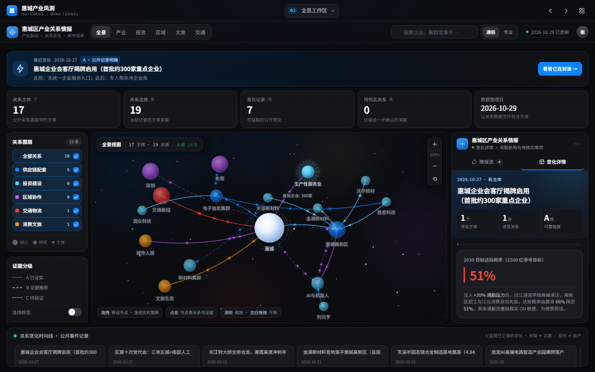
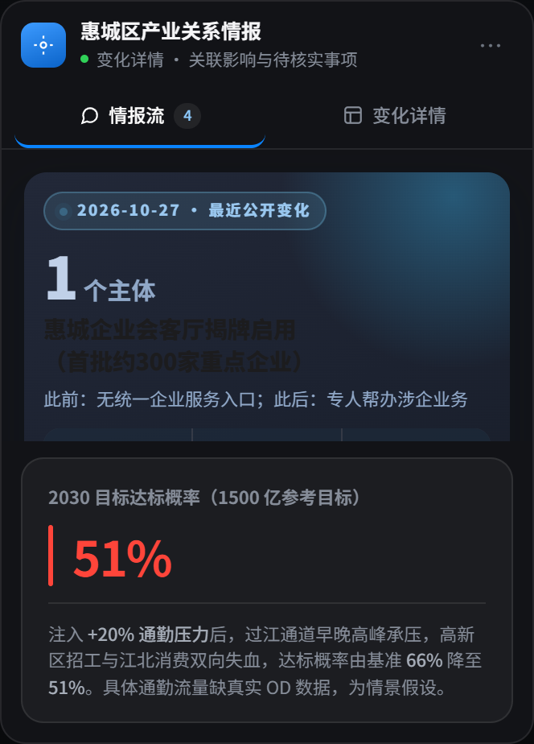
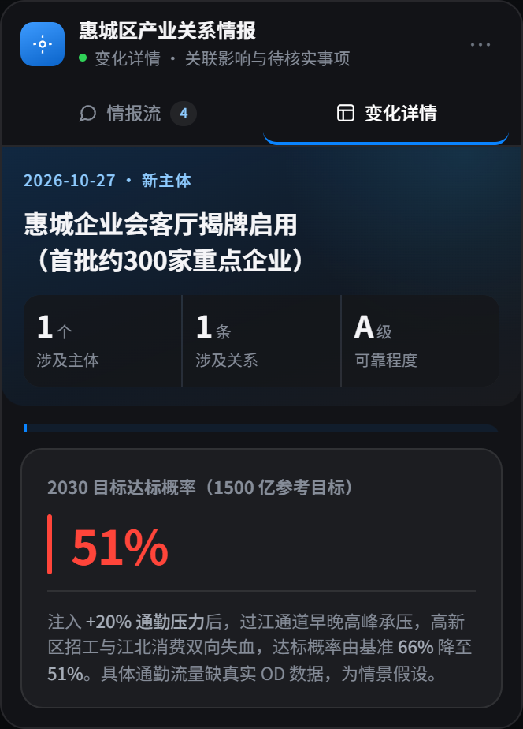
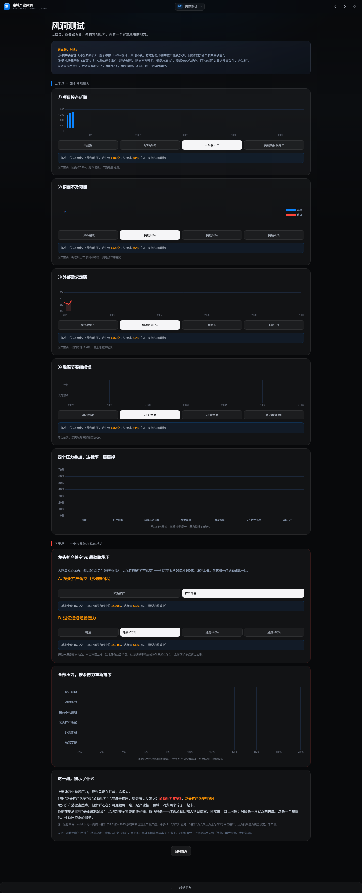
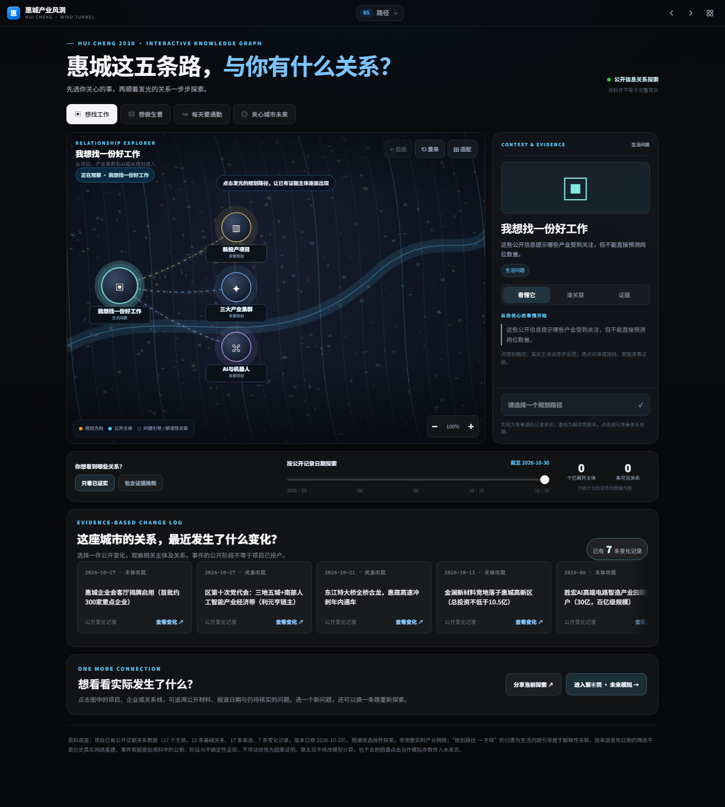
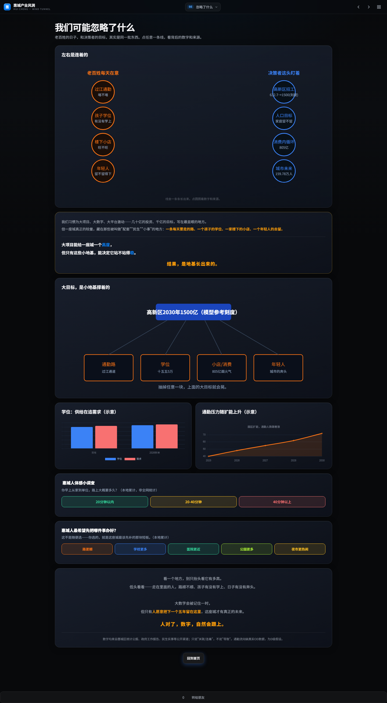

# 惠城产业风洞

### Huicheng Industrial Decision Wind Tunnel

**看见关系 · 发现变化 · 比较情景 · 支撑决策**

一套以惠城区为观察样本、基于公开信息的区域经济关系观察与情景推演工具。

---

## 一句话认识这个项目

**惠城产业风洞不是普通的数据看板，也不是替人拍板的自动决策系统。** 它尝试把分散的公开信息组织成产业与城市关系网络、变化事件、证据线索和可比较的情景，帮助用户发现问题、检查假设、识别未知，并为进一步调查与决策讨论提供支撑。

- **在线首页：** https://zhanglingshare.github.io/huicheng-simulator/
- **全息工作区：** https://zhanglingshare.github.io/huicheng-simulator/holo-workspace.html
- **第三页 · 钱去哪了：** https://zhanglingshare.github.io/huicheng-simulator/today.html
- **项目介绍页：** https://zhanglingshare.github.io/huicheng-simulator/home.html
- **代码仓库：** https://github.com/zhanglingshare/huicheng-simulator
- **许可协议：** 保留所有权利（未经许可不得复制、转载、商用）

---

## 产品亮点 · 页面截图

> **截图说明：** 以下为 README 的正式截图位。为避免用概念图冒充实际功能，截图应来自当前线上真实页面。将截图按指定文件名放入 `assets/screenshots/` 后，即可启用对应图片。建议使用清晰的桌面截图，并在关键位置适度标注。

### 01 · 全息工作区：一眼看见产业与城市的关系

**📸 截图位：** `assets/screenshots/01-holo-workspace.png`（全息工作区总览）
<!-- 图片准备好后，取消下一行注释 -->

**这张图要展示：** 第二页全息工作区的中央关系网络、右侧情报流/变化详情和底部时间线。

**它说明什么：** 项目不只呈现单个指标，而是把主体、关系、事件与时间放进同一观察界面。用户可以从全景入手，再逐步聚焦自己关心的变化。

[进入第二页 · 全息工作区 →](https://zhanglingshare.github.io/huicheng-simulator/holo-workspace.html)

### 02 · 情报流：从公开变化中发现问题

**📸 截图位：** `assets/screenshots/02-intelligence-feed.png`（情报流与变化类型分布）

**这张图要展示：** 真实事件列表、日期、变化类型分布与事件入口。

**它说明什么：** 情报流不应只是新闻标题的堆叠。用户可以先了解当前记录包含哪些类型的变化，再选中具体事件继续追踪。图表统计基于已有记录，不把缺失数据包装成精确数字。

### 03 · 变化详情：把事件放回关系网络中

**📸 截图位：** `assets/screenshots/03-change-detail.png`（变化详情与关系结构图）

**这张图要展示：** 事件说明、关联主体、关系连线、关系类型和可追溯的公开来源。

**它说明什么：** 阅读事件之后，还可以继续问：哪些主体与它相关？有哪些连接值得核对？哪些信息已经有公开依据，哪些仍需调查？关系连接是调查线索，不自动等于因果证明。

### 04 · 风洞测试：比较不同假设下的情景

**📸 截图位：** `assets/screenshots/04-wind-tunnel.png`（风洞测试与情景比较）

**这张图要展示：** 用户可见的情景条件、对比区域和结果呈现。请以线上当前实际页面为准。

**它说明什么：** 区域发展难以在现实中反复做可控实验。情景推演可以在明确条件下进行比较，帮助人们检查原有判断对哪些假设敏感、哪些风险需要提前讨论。它用于压测与探索，不是对未来的保证。

[进入风洞测试 →](https://zhanglingshare.github.io/huicheng-simulator/windtunnel.html)

### 05 · 发展路径：把不同选择放在一起比较

**📸 截图位：** `assets/screenshots/05-pathways.png`（发展路径比较）

**这张图要展示：** 路径选项、比较维度与实际页面提供的差异信息。

**它说明什么：** 讨论不只停留在“要不要做”，还可以继续追问：不同路径依赖什么条件？受到什么约束？还需要补充哪些配套与证据？

[查看发展路径 →](https://zhanglingshare.github.io/huicheng-simulator/choices.html)

### 06 · 盲点与报告：把疑问带回现实核实

**📸 截图位：** `assets/screenshots/06-blindspots-and-report.png`（盲点提示或分析报告）

**这张图要展示：** 盲点提示或报告页面中的实际内容、可读图表与解释说明。

**它说明什么：** 推演的价值不止是显示一个结果，更在于识别容易被忽略的因素、保留待核实问题，并把观察沉淀为可以继续讨论的材料。

[查看盲点提示 →](https://zhanglingshare.github.io/huicheng-simulator/blindspot.html) · [查看分析报告 →](https://zhanglingshare.github.io/huicheng-simulator/report.html)

---

## 这个项目做什么

把分散的公开信息组织成关系网络、变化事件和可以比较的情景，让人先看见结构、再发现变化，然后提出问题。

它不提供答案，只提供可以继续追问的入口：哪些变化值得看、哪些关系值得核对、哪些条件一变结论就变。

数据均来自公开渠道，页面按可核实程度标注；完整来源清单（含日期与版本）可向作者索取，便于逐条核对。

## 如何使用

建议按照以下顺序体验：

1. **先看全景：** 从首页关系网络了解主要主体与连接。
2. **发现变化：** 浏览情报流与变化类型分布，选择值得关注的事件。
3. **追踪关联：** 在变化详情中查看关联主体、关系结构与公开来源。
4. **先选路径，再看未来：** 在路径页提出发展设想，再到未来页观察模拟区间，最后进入风洞页面比较冲击情景。
5. **检查盲点：** 查看尚未充分考虑的因素与证据缺口。
6. **回到现实：** 对重要结论查阅原始来源，并通过调研、核实或专业讨论进一步验证。

在线体验建议使用较新版本的桌面或移动浏览器。如果页面需要读取本地 JSON 数据，请通过本地静态服务器运行，不要仅用 `file://` 直接打开。

## 正式十页体验路线

本项目现仅将以下十页作为正式体验流程。其他旧版页面仍可访问，**不再出现在主要导航中**；这一调整不影响正式十页的正常使用。

| 顺序 | 页面 | 在线入口 | 主要任务 |
|:---:|---|---|---|
| **01** | **序章 · 看见产业关系，理解城市变化** | [进入首页](https://zhanglingshare.github.io/huicheng-simulator/) | 了解为什么做这个项目 |
| **02** | **全息工作区** | [打开全息](https://zhanglingshare.github.io/huicheng-simulator/holo-workspace.html) | 发现变化、看见网络、追溯证据 |
| **03** | **钱去哪了** | [打开钱去哪了](https://zhanglingshare.github.io/huicheng-simulator/today.html) | 从消费与资金去向问题探索关系和证据缺口 |
| **04** | **风向标 · 去哪玩** | [打开风向标](https://zhanglingshare.github.io/huicheng-simulator/fun.html) | 了解惠城日常热点与生活场景 |
| **05** | **路径** | [打开路径](https://zhanglingshare.github.io/huicheng-simulator/choices.html) | 先选择区域发展的路径方向 |
| **06** | **未来** | [打开未来](https://zhanglingshare.github.io/huicheng-simulator/future.html) | 再观察不同情景下的可能结果 |
| **07** | **风洞测试** | [打开风洞](https://zhanglingshare.github.io/huicheng-simulator/windtunnel.html) | 观察条件变化与外部冲击 |
| **08** | **忽略了什么** | [打开盲点](https://zhanglingshare.github.io/huicheng-simulator/blindspot.html) | 发现居民生活与城市承载等盲点 |
| **09** | **报告** | [打开报告](https://zhanglingshare.github.io/huicheng-simulator/report.html) | 汇总观察和讨论依据 |
| **10** | **结语** | [打开结语](https://zhanglingshare.github.io/huicheng-simulator/ending.html) | 回到人、城市与决策责任 |

> **导航边界：** 网站根目录 `index.html` 为第一页面；`home.html` 保留作为同一序章的介绍入口；`holo-workspace.html` 是第二页。原来的 `money.html` 不再是正式第三页，第三页统一使用已包含漏斗图的 `today.html`。

---

## 数据来源、证据与使用边界

项目以公开信息为基础，尽可能提供来源线索，方便读者回到原始材料核查。具体数据的覆盖范围、更新频率和可验证程度可能不同，应以页面标注和原始来源为准。

### 阅读证据时请注意

- **公开信息不等于完整信息。** 资料可能存在发布时间差、统计口径差异、缺失项或未披露内容。
- **不同项目阶段不能混为一谈。** 签约、竞地、开工、建设、投产与形成实际产出是不同阶段。
- **关系不等于因果。** 网络连接用于呈现关联线索，不能单独证明某个因素必然导致某种结果。
- **情景结果不是确定预测。** 结果依赖于所使用的数据、假设和适用边界；条件变化时，结果也可能变化。
- **数据更新不等于结论变化。** 新增公开记录、刷新页面数据，与结论的调整是不同的事情。
- **不构成投资建议或官方决策依据。** 本项目用于辅助理解与提出问题，不替代专业判断、正式统计或法定程序。

## 项目原则

- **先看见，再比较：** 先观察结构与变化，再进入深入推演。
- **让可视化承担解释任务：** 图表用于帮助识别连接、分布、差异与时间顺序，而不是装饰。
- **让依据可以追溯：** 重要记录尽可能关联来源、日期与说明。
- **把不确定性说清楚：** 数据不足时标注未知、推断和待核实事项。
- **允许质疑与修正：** 欢迎对数据、来源、口径和体验提出有依据的反馈。
- **尊重现实决策责任：** 工具帮助提出问题，现实调查和决策程序负责核实与判断。

## 关于作者

本项目由 **张凌博士** 利用业余时间独立完成，是面向公开数据与区域决策体验的个人开源尝试，不代表任何单位立场。

作者简介：张凌博士，高校副教授、南粤优秀教师、国际 SCI 期刊审稿人、广东省乡村振兴驻镇工作队成员，曾任驻村第一书记。

联系方式：68588368@qq.com ｜ zhangyu0703@gmail.com

欢迎通过 GitHub Issues 提交数据更正、来源补充或体验建议。

## 许可协议

Copyright © 2026 张凌（Zhang Ling）。

本项目采用 [保留所有权利](./LICENSE) 声明。允许个人浏览、分享链接与少量引用（须署名并附来源）；未经书面许可，不得复制、转载、镜像、商用、改编，亦不得用于训练人工智能模型。如需转载、合作或商业使用，请联系作者。

---

**让每一个重大决策，多一种先看一看的可能。**

*不替代决策，而是引出问题、支撑决策。*

